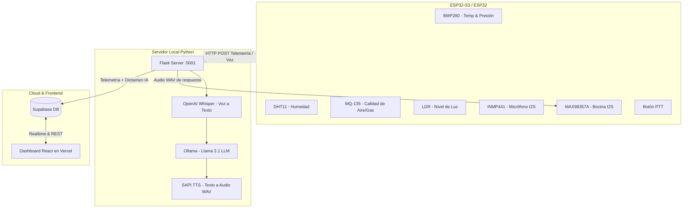

# 🌿 Asistente Ambiental Inteligente con Llama 3.1 & ESP32 (BioSense)

Sistema IoT embebido para monitoreo ambiental en tiempo real, análisis mediante Inteligencia Artificial local (**Llama 3.1** vía Ollama), síntesis de voz, telemetría en **Supabase** y dashboard web minimalista en **React** desplegado en **Vercel**.

---

## 🛠️ Arquitectura del Sistema

---

## 📂 Estructura del Repositorio

- **`sketch_oct16b_copy_20261022171225/`**: Código Arduino (.ino) para el ESP32:
  - Lectura de sensores I2C (BMP280 en `0x76`) y analógicos/digitales (DHT11, MQ-135, LDR).
  - Grabación de voz en streaming I2S con INMP441 mediante botón PTT (GPIO 15).
  - Reproducción de audio en tiempo real con amplificador I2S MAX98357A con detección automática de tasa de muestreo (Sample Rate) y finalización instantánea sin demoras.
- **`prueba_minima.py`**: Servidor en Flask:
  - Recibe audio y transcribe con Whisper.
  - Procesa dictámenes ambientales y meteorológicos con Llama 3.1 bajo normativas **ISO 7730** e **ISO 17772-1**.
  - Genera respuesta en audio WAV para el ESP32.
  - Sincroniza lecturas y dictámenes automáticamente con Supabase.
- **`dashboard/`**: Aplicación web frontend en **React**:
  - Estilo minimalista monocromático en tonalidades verde pastel.
  - Sincronización en vivo con Supabase (Realtime y polling).
  - Despliegue listo para Vercel.

---

## 📋 Normas Evaluadas por la IA
1. **ISO 7730 (Confort Térmico):**
   - Temperatura de confort: 18.0 °C a 26.0 °C.
   - Humedad relativa recomendada: 30 % a 60 %.
2. **ISO 17772-1 (Calidad del Aire Interior):**
   - Concentración de gases/CO₂ aceptable: < 1000 ppm.

---

## 🚀 Despliegue del Dashboard en Vercel
1. Ejecuta el script `dashboard/supabase_schema.sql` en el SQL Editor de tu panel de Supabase.
2. En [Vercel](https://vercel.com), importa este repositorio y selecciona la carpeta raíz `dashboard` como **Root Directory**.
3. Vercel detectará automáticamente la configuración de **Create React App** y desplegará tu dashboard en segundos.
